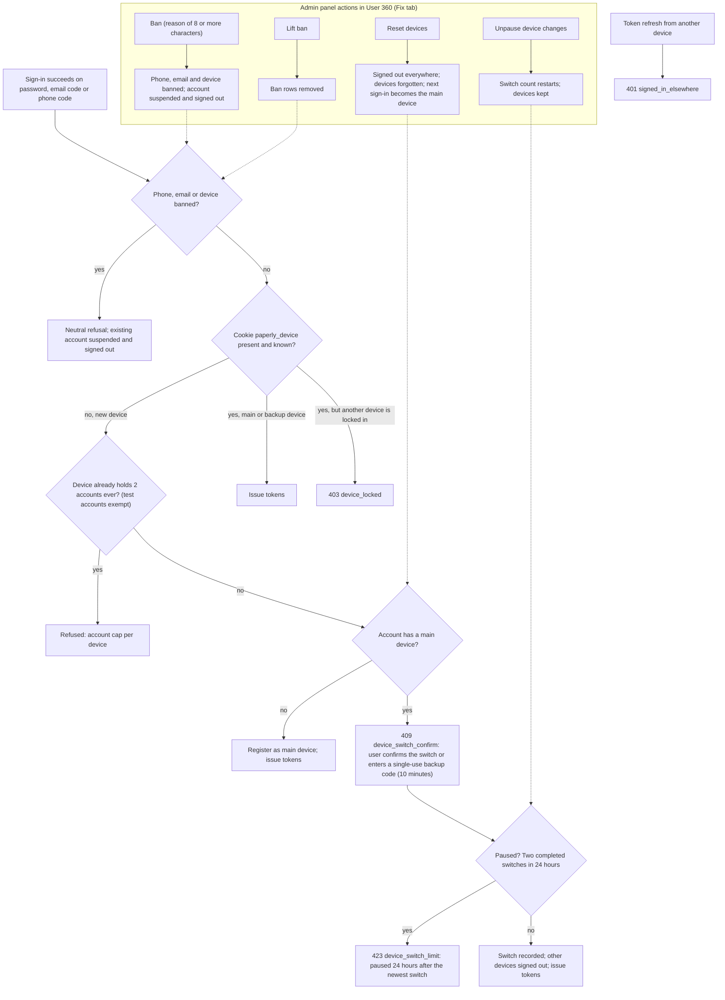

# Architecture diagrams (the Architecture page)

Last updated: 2026-10-13. The Architecture page (owner only) holds 88 diagrams covering all three repositories: the backend (`paperly-mvp`), the teacher module and this admin panel. The page is a library, not one picture: each diagram links to more detailed ones, so a reader can stop at level 0 or go down to level 3 and beyond.

## Contents

| Family | What the diagram shows | Count |
|---|---|---|
| Data flow (DFD) | Level 0 whole system, level 1 eight processes, level 2 eleven areas, level 3 fourteen single mechanisms | 27 |
| System structure (C4) | Context, containers, and level 3 components for the backend areas, the teacher module and the admin panel | 9 |
| Sequences | One scenario each, in call order: sign-in, token refresh, checkout, ad unlock, PDF export, AI check, SQL run, refund, institute join, template ingestion | 13 |
| Database (ER) | Overview plus templates, teacher and sign-in, billing, organisations, admin and audit tables | 6 |
| State machines | Template, subscription, idempotency record, institute request, plan config version, browser session, builder stages | 7 |
| Flows and maps | Teacher page map, provider stack, API client, builder, full portion, checking, billing, preview modal, draft saving, plan gates; admin page map, gateway, session, database area, this page | 15 |
| Deployment and operations | Deployment map, request path, CI and tests, backup and restore, config switches, generation capacity | 6 |
| Security | Trust boundaries, token lifecycle, row level security, admin roles, rate limits | 5 |

Start at **Level 0: system context**. Each diagram page shows the purpose, notes that were checked against the code, the files where the real thing lives, links to deeper diagrams ("Go deeper") and sideways links ("Related").

## How the page works

- Every diagram is an entry in `src/lib/architecture/diagrams/*.ts`: id, title, repo, family, level, summary, Mermaid source, `children`, `related`, `notes`, `files`.
- `src/lib/architecture/catalog.ts` joins the files and checks the entries. `catalog.test.ts` fails if an id is duplicated, a link points nowhere, a DFD or C4 diagram has no level, a level 1 to 3 DFD has no parent, or the Mermaid type is unknown.
- `src/pages/architecture.tsx` is the page (search, repo and family filters, breadcrumb, drill down). `src/components/architecture/DiagramViewer.tsx` draws one diagram with Mermaid, loaded on first use, security level strict, with zoom and pan.
- The page address keeps the open diagram (`/architecture?d=<id>`), so a diagram can be bookmarked.

## Adding or changing a diagram

1. Add an entry to the right file under `src/lib/architecture/diagrams/`. Write the source in a `String.raw` template (no backticks, no `${`).
2. Put the new id in the `children` of the diagram that should lead to the new one, and list neighbours in `related`.
3. Keep `notes` to facts checked in the code, and `files` to repo-relative paths (`backend/...`, `teacher-module/...`, `admin-panel/...`, `paperly-mvp/...`).
4. Run `npm test`. Mermaid mistakes only show when the diagram is drawn, so open the page and look at the diagram too.

Mermaid reminders: do not use `call`, `click`, `end`, `style`, `class`, `default` or similar words as node ids. Keep node text in double quotes if the text has brackets or colons.

## Access

The page is owner-only in the interface (sidebar entry and a notice on the page). The diagrams are part of this panel's own code, not data from the backend, so this is a convenience gate, not a secret store: do not put passwords, keys or private customer data in a diagram. The panel is only run on the owner's computer.

To let other roles see the page, remove `ownerOnly: true` from the Architecture entry in `src/components/AppShell.tsx` and the `isOwner` check in `src/pages/architecture.tsx`.

## Device sign-in and ban flow (2026-10-13)

Source for the one-ID-one-device decision at sign-in and for the admin actions that lift or add a block. The diagram follows the backend gate `_issue_teacher_auth_response`; the device cookie is `paperly_device` (`__Host-` prefix in production, 400 days, only an HMAC stored). The diagram is recorded here as Mermaid source and is not yet an entry in `src/lib/architecture/diagrams/` (adding the entry there is the next step, with the `files` list `backend/app/api/routes/teacher_auth_routes.py`, `backend/app/api/routes/admin_user_actions.py`, `backend/app/services/teacher_bans.py`).

Every admin action here writes to the admin action log. Limits: a device ban is a cookie and a website cannot read a hardware ID; a shared remote-desktop machine counts as one device; passkeys and a mobile app are later steps.

## Known limits

- Diagrams are written by hand from the code and docs on 2026-10-12. Diagrams do not update automatically: when a flow changes, update the entry (the `files` list says where to look).
- The `files` paths cross repositories, so the test in this repo cannot check that the files exist. All paths were checked once when written.
- The device sign-in and ban diagram above lives in this document only until added to the page catalog.
- Level 3 stops at mechanisms. Below that, the files listed on each diagram are the next level down.
